# roomwise

[English](README.md)

roomwise zeigt dein Zuhause als Grundriss in Home Assistant und macht ihn zur Fernbedienung. Du zeichnest die
Räume einmal, stellst Lampen, Heizkörper, Fenster und den Saugroboter dorthin, wo sie wirklich sind, und ab dann
bedienst du das Haus über den Plan: Raum antippen und das Licht geht an, Heizkörper antippen und die Temperatur
ändern, auf einen Blick sehen, welches Fenster noch offen ist. Gedacht ist es für das Tablet, das den ganzen Tag an
der Wand hängt.

Hinter dem Plan arbeitet **Hausregeln**, eine zweite Integration für das, was ein Zuhause von selbst tun sollte:
Licht, das den Menschen im Raum folgt, Heizung, die bei offenem Fenster pausiert, ein Hausmodus, der weiß, wann alle
weg sind, eine Alarmanlage und Regeln, die man als ganz normale Sätze schreibt.

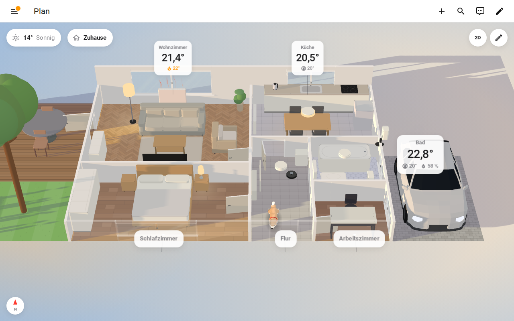

> **Beta.** roomwise läuft jeden Tag in einem Haushalt und wird gegen eine Test-Instanz mit simulierten Geräten
> getestet, ist aber noch kaum in anderen Wohnungen gelaufen. Rechne mit Ecken und Kanten und
> [melde sie bitte](https://github.com/jonasstack/roomwise/issues). Die Oberfläche ist zuerst deutsch; die Karte kann
> auch Englisch, Hausregeln vorerst nur Deutsch.

| | |
|---|---|
| 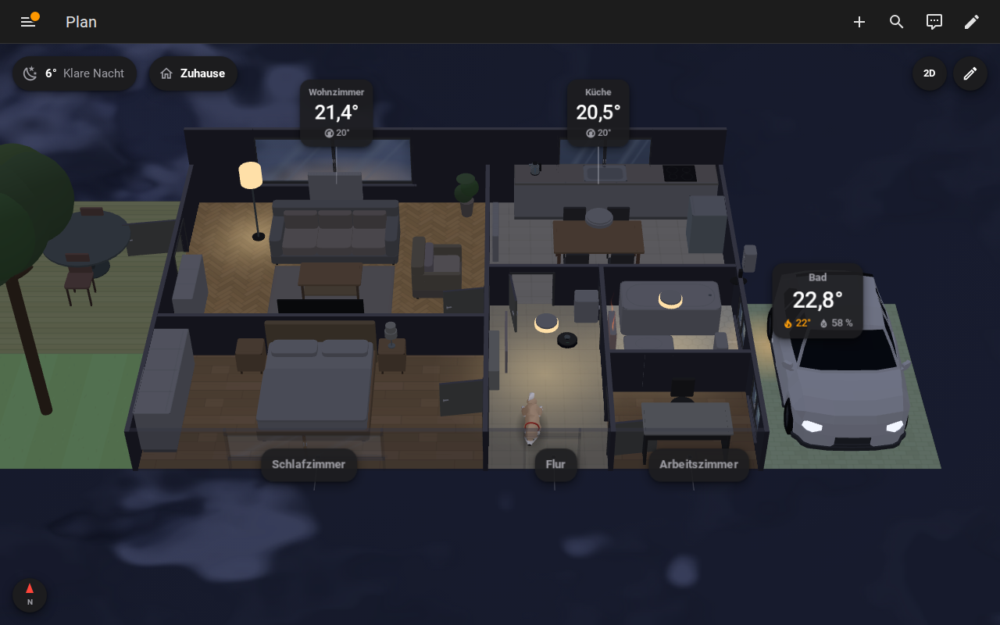 | 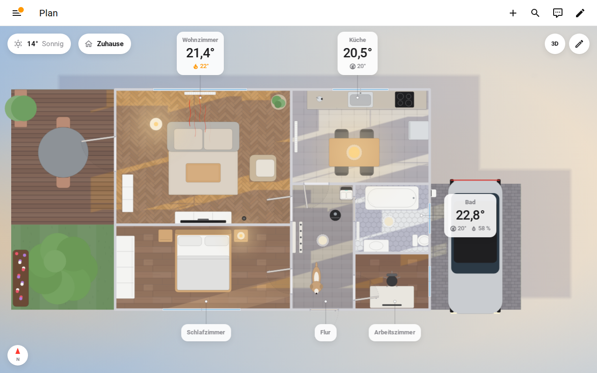 |
| 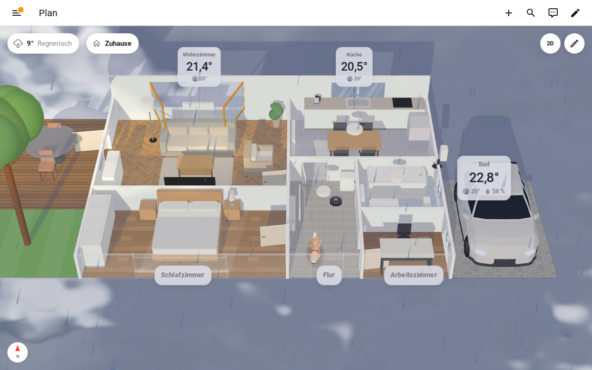 | 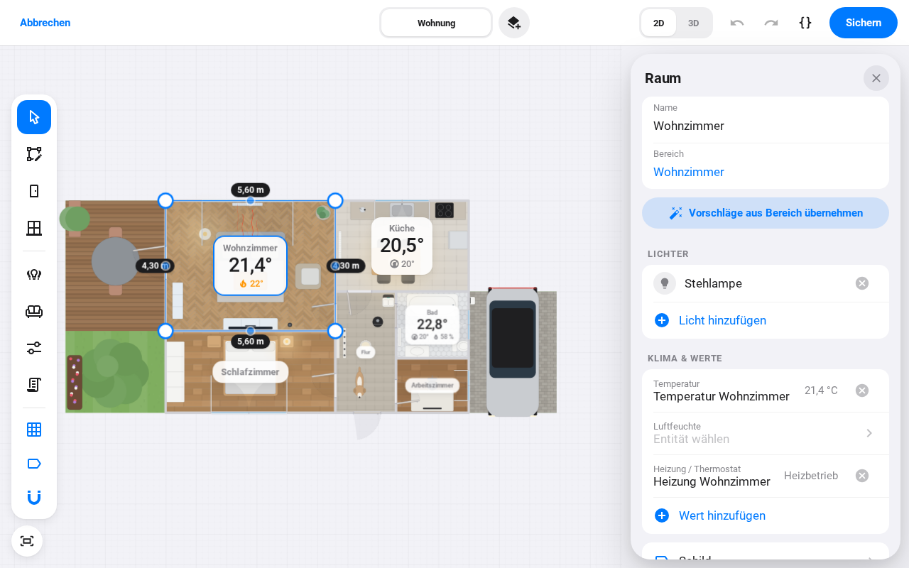 |

Alle Bilder zeigen die Demo-Wohnung aus [`examples/demo.json`](examples/demo.json).

## Inhalt

- [Was es kann](#was-es-kann)
- [Voraussetzungen](#voraussetzungen)
- [Installation](#installation)
- [Erste Schritte](#erste-schritte)
- [Konfiguration](#konfiguration)
- [Unterstützte Geräte](#unterstützte-geräte)
- [Browser](#browser)
- [Wandtablets](#wandtablets)
- [Datenschutz](#datenschutz)
- [Fragen und Probleme](#fragen-und-probleme)
- [Wie es weitergeht](#wie-es-weitergeht)
- [Wie roomwise entsteht](#wie-roomwise-entsteht)
- [Lizenz und Danksagung](#lizenz-und-danksagung)

Die [Anleitung](docs/guide/README.de.md) erklärt alles Schritt für Schritt.

## Was es kann

**Das Zuhause zeichnen.** Ein Editor direkt in der Karte: Räume Punkt für Punkt oder als Rechteck, mit echten
Wandlängen (1 Einheit = 1 cm), Türen und Fenster an den Wänden, mehrere Etagen, Außenbereiche wie Terrasse, Garten
oder Einfahrt, die Grundstücksgrenze und Garagen (angebaut oder als eigenes Gebäude). Über 130 Arten von Möbeln und Geräten, Bodenbeläge und Wandfarben. Ordnest du einem Raum einen Bereich
von Home Assistant zu, schlägt die Karte Lichter, Thermometer, Thermostat und Fensterkontakte vor. YAML ist nicht
nötig; der Plan wird wie jede andere Karte im Dashboard gespeichert.

**Sehen und schalten.** Der Plan zeigt den echten Zustand: beleuchtete Räume leuchten warm, Lampen in ihrer
eigenen Farbe, Heizkörper zeigen, wenn sie heizen, offene Fenster und Türen stehen im Plan offen, Temperatur und
Luftfeuchte stehen an den Räumen. Antippen schaltet, langes Drücken öffnet ein passendes Bedienfeld (Licht,
Thermostat, Rollladen, Garagentor, Musik, Saugroboter, Mähroboter, Ventil, Einkaufsliste, Auto), und jede Geste lässt sich anders belegen.
Die Ansicht ist ein ruhiges 3D-Modell mit echter Sonne, Himmel und Wetter oder ein flacher 2D-Plan.

**Regeln, die sich wie Sätze lesen.** Hausregeln schreibt Automationen als Sätze: *Wenn die Haustür aufgeht und
niemand zuhause ist, schick mir eine Nachricht.* Man baut sie im Satz-Editor oder tippt sie einfach ein, und jeder
Lauf steht mit Grund im Verlauf, sodass „Warum ist gerade das Licht angegangen?“ eine Antwort hat. Hausregeln kennt
auch die Automationen, die du schon hast, und schlägt Regeln zu den gefundenen Geräten vor.

**Licht je Raum.** Statt zehn Regeln pro Raum bekommt jeder Raum einen Lichtplan: was passiert, wenn jemand
hereinkommt, wenn der Raum leer ist, nachts, solange der Fernseher läuft. Von Hand geschaltetes Licht bleibt eine
Weile in Ruhe.

**Heizung je Raum.** Ein Ziel pro Raum aus Zeitplänen und Hausmodus, aus oder Frostschutz bei offenem Fenster,
gelernte Aufheizzeiten je Raum und Lüft-Erinnerungen nach Feuchte, CO₂ oder Uhrzeit.

**Hausmodus und Anwesenheit.** Zuhause, Weg, Schlafen, Urlaub oder Gäste, automatisch danach, wer zuhause ist und
welche Räume belegt sind. Räume wissen über Bewegungs- und Präsenzmelder, ob jemand drin ist, und mit Tür-Logik
bleibt ein Raum belegt, solange die Tür zu ist.

**Alarmanlage.** Scharf weg, nachts oder zuhause, mit Ein- und Ausgangsverzögerung, Sirenen und Licht, Nachrichten
aufs Handy (mit einem Ausschalt-Knopf, den das Handy mit seiner eigenen Sperre absichert), wahlweise PIN oder
Face ID / Touch ID zum Ausschalten, und eine Fenster-Warnung, wenn die Haustür aufgeht, während noch Fenster offen
sind.

**Und sonst.** Ein Saugroboter, der live durch den Plan fährt (Roborock, Dreame, Xiaomi, Valetudo), Garagentore und Einfahrtstore, die sich
live über ihr `cover` öffnen (Öffnen fragt immer nach), ein Mähroboter, der seinen Rasen in Bahnen mäht,
Bewässerungszonen, die Wasser zeigen, solange ihr Ventil läuft, Autos mit Akku und Laden, Solaranlage,
Batteriespeicher und Wärmepumpe, Hunde, die an der Tür warten, wenn Gassi fällig ist, und ein Urlaubsmodus, der
das Licht deiner echten Tage nachspielt.

| | | |
|---|---|---|
| 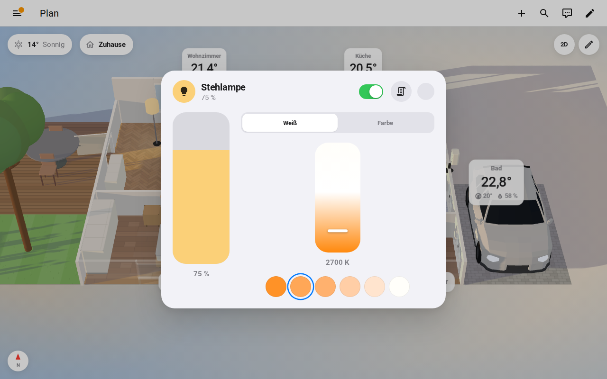 | 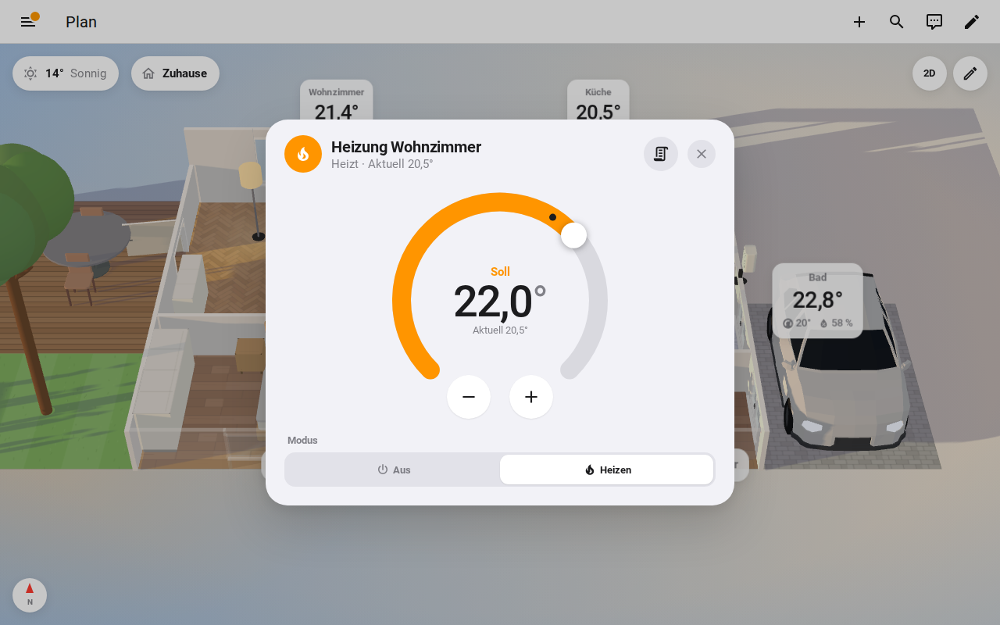 | 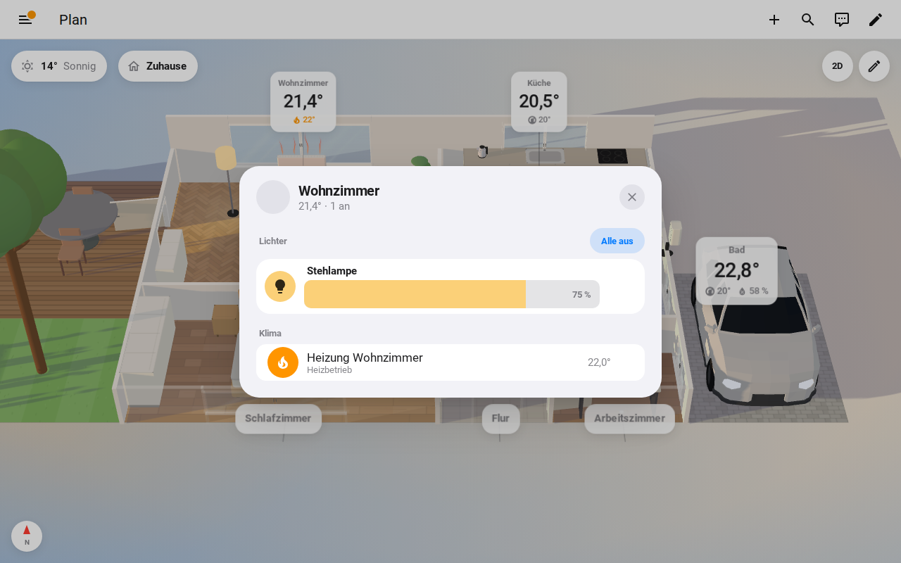 |
| 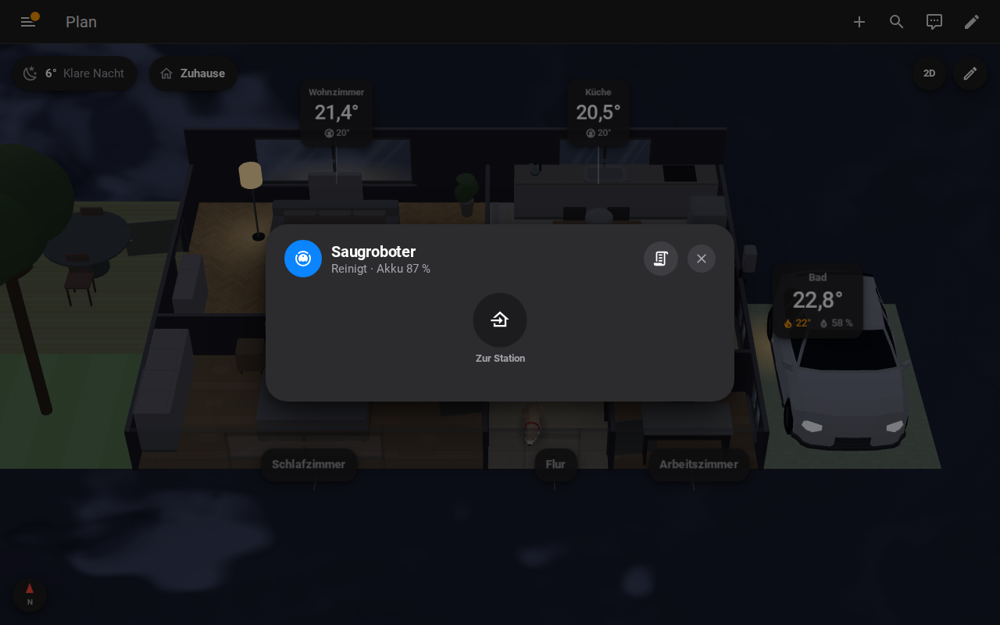 | 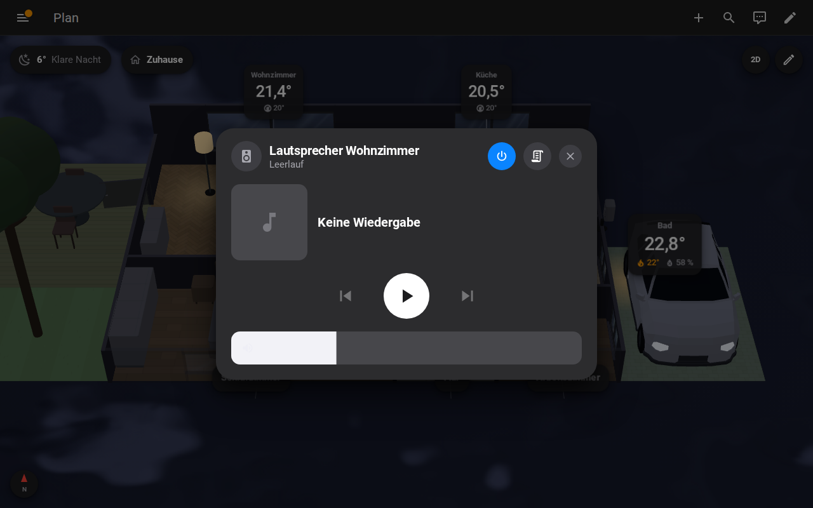 | 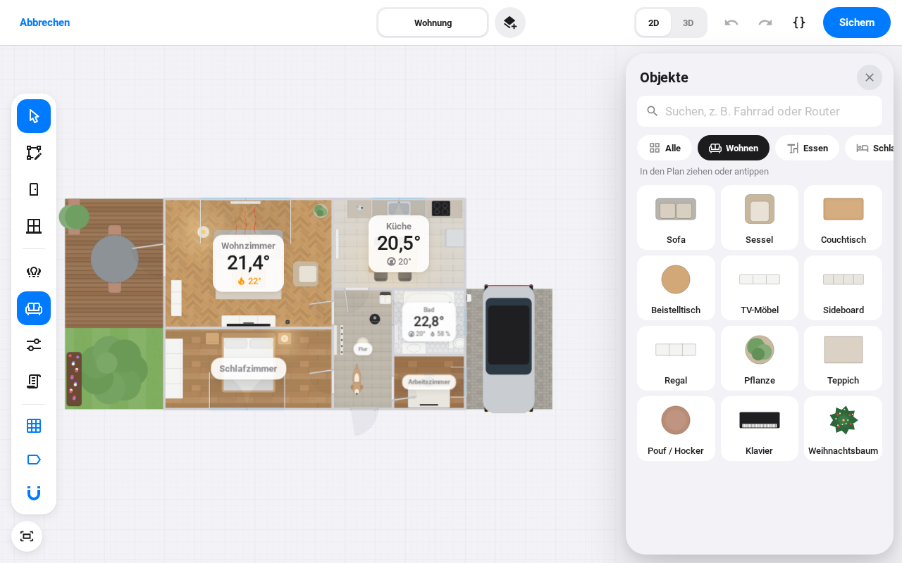 |

## Voraussetzungen

- Home Assistant ab 2025.1
- HACS 2.x für Installation und Updates
- Ein Dashboard im Speichermodus (Standard, in der Oberfläche bearbeitbar), wenn du aus dem Editor der Karte
  speichern willst
- Für die 3D-Ansicht ein Browser mit WebGL; ohne fällt die Karte auf eine einfachere 3D-Ansicht oder 2D zurück

## Installation

roomwise ist eine Integration: Sie bringt die Karte auf jedes Dashboard, erledigt, was ohne Tablet funktionieren
muss (Haustür-Warnung, Gassi-Erinnerungen, Saugroboter live), und legt **Hausregeln** (Regeln, Hausmodus, Licht-
und Heizpläne, Alarmanlage) in die Seitenleiste.

1. HACS → ⋮ (oben rechts) → **Benutzerdefinierte Repositories** → URL `https://github.com/jonasstack/roomwise`, Typ
   **Integration** → **Hinzufügen**.
2. *roomwise* in HACS öffnen → **Herunterladen**.
3. Home Assistant neu starten.
4. Einstellungen → Geräte & Dienste → **Integration hinzufügen** → *roomwise*. Es gibt nichts auszufüllen.
5. Browser neu laden (auf dem Tablet die Kiosk-App neu laden). Die Karte steht jetzt auf jedem Dashboard bereit
   (keine Ressource einzutragen), und in der Seitenleiste erscheint **Hausregeln**. Beim ersten Öffnen startet der
   Einrichtungsassistent; jeden Schritt kannst du überspringen.

Von Hand: `roomwise.zip` aus dem [neuesten Release](https://github.com/jonasstack/roomwise/releases) laden und so
entpacken, dass `manifest.json` direkt in `<config>/custom_components/roomwise/` liegt.

Nach der Installation läuft nur der automatische Hausmodus. Alles andere (Alarmanlage, Lichtpläne, Heizung,
Urlaub, KI) bleibt aus, bis du es im Einrichtungsassistenten oder in Hausregeln unter Einstellungen → Funktionen
einschaltest.

**Umstieg von 0.1.0-beta.3 oder älter** (zwei Integrationen, *Grundriss-Karte* `floorplan_card` und *Hausregeln*
`house_rules`): roomwise installieren und neu starten. Beim Hinzufügen von roomwise (oder unter Einstellungen →
Reparaturen) bietet es an, die alten Ordner wegzuräumen (es wird nichts gelöscht) und neu zu starten – einfach
bestätigen. Die alten Integrationen unter Geräte & Dienste nicht löschen, dabei würden ihre Einstellungen gelöscht. roomwise übernimmt Einstellungen, Regeln und Entitäten mit denselben
Entitäts-IDs. Die Aktionen heißen jetzt `roomwise.run`, `roomwise.pause` und `roomwise.reset_alarm_pin`.

## Erste Schritte

1. Ein Dashboard für das Tablet anlegen und den Ansichtstyp **Panel** wählen, damit eine Karte den Bildschirm füllt.
2. Dashboard bearbeiten → **Karte hinzufügen** → *Floorplan Card*. Nutzt du Bereiche in Home Assistant, beginnt die
   Karte mit einem Rechteck pro Bereich, schon mit Lichtern und Sensoren verknüpft.
3. Auf den **Stift** tippen und die Räume zeichnen. Ecken ziehen, um Wandlängen anzupassen, oder Längen eintippen.
4. Einen Raum auswählen und seinen **Bereich** wählen: Lichter, Thermometer, Thermostat und Fensterkontakte werden
   vorgeschlagen. Türen und Fenster an die Wände setzen und ihnen ihre Kontaktsensoren geben.
5. Geräte aus der Entitätenliste und Möbel aus der Bibliothek in den Plan ziehen. Eine Lampe oder einen Heizkörper
   mit seiner Entität verknüpfen, damit er leuchtet oder Wärme zeigt.
6. **Speichern** antippen.

Die [Anleitung](docs/guide/README.de.md) beschreibt den ersten Grundriss, Geräte, Regeln, Heizung und Alarmanlage
ausführlicher.

## Konfiguration

Alles lässt sich im Editor der Karte einstellen (das Zahnrad im Editor enthält die Karten-Einstellungen).
Gespeichert wird ganz normales Karten-YAML; diese Optionen sucht man am häufigsten:

| Option | Standard | Bedeutung |
|---|---|---|
| `title` | keiner | Titel oben links |
| `height` | aus dem Plan | CSS-Höhe, z. B. `calc(100vh - 56px)` |
| `view_mode` | `auto` | `auto` (3D, wo das Gerät es schafft), `3d` oder `2d`; der Knopf in der Karte schaltet trotzdem um |
| `performance` | `high` | `high` oder `eco` (geringere 3D-Auflösung, keine Animationen im Leerlauf) |
| `effects` | `auto` | `auto`, `on` oder `off` für Animationen; `auto` beachtet „Bewegung reduzieren“ |
| `weather` | erste `weather.*` | Wetter-Entität für Himmel und Wettereffekte |
| `north` | `0` | Richtung Norden im Plan, Grad im Uhrzeigersinn |
| `theme` | `auto` | `auto`, `light` oder `dark` |
| `editable` | `true` | Stift anzeigen (sehen ohnehin nur Administratoren) |
| `users.<user id>` | keine | Eigene Vorgaben je Person, etwa `view_mode`, `performance` oder `floor` |
| `floors` | | Räume, Öffnungen, Geräte und Möbel je Etage, schreibt der Editor |

Antippen, Doppeltippen und langes Drücken auf Räume, Geräte, Türen und Fenster nutzen das bekannte Aktionsformat
von Home Assistant (`toggle`, `more-info`, `perform-action`, `navigate`, `url`, `none`) und zusätzlich
`toggle-lights`, `popup` und `zoom` der Karte. Jede Aktion kann mit `confirmation: true` vorher fragen; Schlösser,
Alarmanlagen und Sirenen fragen immer.

Ein kleines Beispiel von Hand steht in [`examples/basic.yaml`](examples/basic.yaml), die Demo-Wohnung der Bilder in
[`examples/demo.json`](examples/demo.json).

## Unterstützte Geräte

roomwise arbeitet mit Entitäten, nicht mit Marken: Was Home Assistant als Licht, Thermostat oder Kontaktsensor
zeigt, kann die Karte nutzen. Manches braucht mehr als die üblichen Entitäten:

| Funktion | Geht mit | Grenzen |
|---|---|---|
| Licht, Schalter, Ventilatoren, Rollläden, Medienplayer, Heizung | jeder Integration | Farbe und Farbtemperatur nur, wo das Licht sie meldet |
| Türen und Fenster | jedem `binary_sensor` mit offen/zu | |
| Raumbelegung (Hausregeln) | Bewegungs-, Präsenz- und Belegungsmeldern, Präsenz-Zonen | Räume nur mit Türkontakt nutzen allein die Tür-Logik |
| Saugroboter-Bedienfeld und Raumreinigung | jeder `vacuum`-Entität | Raumauswahl braucht `vacuum.clean_area` oder (mit der Integration roomwise) einen Roboter, dessen Integration Räume reinigt: Dreame Vacuum, Xiaomi Miio, Valetudo (MQTT) |
| Saugroboter fährt live im Plan | **Roborock** (Integration aus Home Assistant), **Dreame Vacuum**, **Xiaomi Cloud Map Extractor** oder jede Kartenkamera mit `calibration_points` (wie für die Xiaomi Vacuum Map Card), **Valetudo** (seine Kamera „Map data“) | Die Kartenquelle wird selbst gefunden. Außer Roborock nur gegen simulierte Roboter im echten Datenformat getestet. Kartenkameras melden nur alle paar Sekunden, der Roboter fährt dann weiter hinterher. Andere Marken bekommen das Bedienfeld ohne Live-Ansicht |
| Autos | gebaut mit Mercedes me, geht mit allgemeinen Entitäten für Akku, Reichweite, Laden und Ort | Ladegrenze und Vorklimatisierung je nach Integration des Autos |
| Heizung (Hausregeln) | `climate`-Entitäten, wahlweise Raumthermometer und Fensterkontakte | Hinweise zur Ventilstellung nur, wo das Thermostat sie meldet |
| Alarm-Nachrichten | Companion-App von Home Assistant, `notify`-Dienste, E-Mail über deinen SMTP-Server, Telegram und Signal über CallMeBot | Kritische Hinweise hängen von Handy und App ab |
| Regeln als Satz | eingebaute Satzerkennung für Deutsch; wahlweise KI (Ollama, Gemini, OpenAI, Anthropic, Mistral, OpenAI-kompatibel) | Noch keine englischen Sätze |

Zeigt sich etwas nicht oder verhält sich seltsam, hilft eine
[Geräte-Anfrage](https://github.com/jonasstack/roomwise/issues/new/choose) mit den Attributen der Entität am meisten.

## Browser

<!-- TODO: Browser-Matrix (wird getrennt ergänzt) -->

*Folgt.*

## Wandtablets

Die Karte ist für Bildschirme gebaut, die nie ausgehen. Sie fragt nichts regelmäßig ab, die 3D-Szene zeichnet nur
neu, wenn sich etwas ändert, und Animationen im Leerlauf werden langsamer und hören auf einem unberührten Tablet ganz
auf.

- Im Editor unter *Effekte & Leistung* (auch je Person) *Voll*, *Sparsam* oder *Aus* wählen. *Sparsam* hält den
  Himmel still und zeichnet 3D in geringerer Auflösung, passend für ältere oder günstige Tablets.
- 2D ist die leichteste Ansicht.
- Den Kompass zwei Sekunden halten zeigt Bilder pro Sekunde, Bildzeit, Auflösung und Grafikchip in der Karte.
- Eine Kiosk-App wie Fully Kiosk Browser blendet Kopfzeile und Seitenleiste von Home Assistant aus und kümmert
  sich ums Dimmen.

Gemessen wurde bisher in Chromium am Desktop mit auf Tablet-Tempo gedrosselter CPU, noch nicht auf vielen echten
Tablets. Werte aus der Anzeige zusammen mit deinem Tablet-Modell helfen sehr.

## Datenschutz

Alles bleibt in deinem Home Assistant. Karte und Kartenteil von roomwise sprechen mit keinem Dienst im Internet; sogar
die 3D-Modelle kommen von deiner eigenen Instanz. Hausregeln spricht nur nach außen, wenn ein Administrator es
einrichtet: mit dem gewählten KI-Anbieter, mit CallMeBot für Telegram und Signal, mit deinem eigenen SMTP-Server.

Falls anonyme Diagnosedaten dazukommen, dann nur nach Zustimmung, standardmäßig aus und mit einer Vorschau, was
gesendet würde. Einzelheiten in [PRIVACY.md](PRIVACY.md).

## Fragen und Probleme

**„Custom element doesn't exist: floorplan-card“.**
Nach der Installation Home Assistant neu starten, die Integration unter Einstellungen → Geräte & Dienste
hinzufügen, dann den Browser neu laden. Hilft das nicht, den Cache von Browser oder Kiosk-App leeren. Hast du die
Karte früher von Hand als Ressource eingetragen, diese Ressource entfernen.

**Ich sehe den Stift nicht.**
Bearbeiten dürfen nur Administratoren, und `editable: false` blendet ihn aus. Auf einem Tablet, das sich als
normale Person anmeldet, ist das so gewollt.

**Speichern klappt nicht.**
Der Editor kann nur in Dashboards speichern, die in der Oberfläche verwaltet werden. Für YAML-Dashboards den
Knopf `{}` im Editor nehmen und die Konfiguration selbst einfügen.

**Antippen eines Raums schaltet kein Licht.**
Der Raum braucht Lichter: einen Bereich zuordnen oder in den Raum-Einstellungen Lichter wählen.

**Das Tablet wird warm oder 3D ruckelt.**
Für die Person des Tablets unter Effekte & Leistung *Sparsam* oder *Aus* wählen, oder 2D nutzen.

**Der Saugroboter fährt nicht im Plan.**
Die Live-Ansicht braucht die Integration roomwise und einen Roboter, dessen Integration die Position liefert
(Roborock, Dreame Vacuum, Xiaomi Cloud Map Extractor, Valetudo). Im Editor den Saugroboter auswählen: Er zeigt, woher
die Position kommt (oder dass keine gefunden wurde), und lässt eine andere Karten-Entität wählen. Dann seine Karte am
Plan ausrichten.

**Welche Sprache?**
Die Sprache deines Home Assistant: Deutsch für `de`, sonst Englisch. Hausregeln gibt es vorerst nur auf Deutsch.

**Ersetzt roomwise meine Automationen?**
Nein. Hausregeln läuft neben ihnen, zeigt sie an und kann vorschlagen, mehrere davon zu einer Regel
zusammenzufassen, ändert oder schaltet aber nie selbst eine Automation ab.

## Wie es weitergeht

- Eine Integration statt zwei, in einem Schritt über HACS installiert, mit Übernahme der bisherigen Einstellungen
- Hausregeln auf Englisch, auch die Regeln als Satz
- Weitere Geräte mit Live-Position (Saug- und Mähroboter), wo Integrationen sie liefern
- Anonyme Diagnose nach Zustimmung, um zu lernen, welche Geräte und Tablets genutzt werden

Ideen und Wünsche gern als [Feature-Anfrage](https://github.com/jonasstack/roomwise/issues/new/choose).

## Wie roomwise entsteht

roomwise wird von jonasstack zusammen mit Claude von Anthropic (Claude Code) als Programmierpartner
entwickelt. Was roomwise können soll, wie es sich anfühlen soll und ob eine Änderung gut genug ist, kommt von mir und
aus dem täglichen Leben damit; der größte Teil des Codes entsteht im Gespräch mit Claude, wird dann ausgeführt, an
einer Test-Instanz und in einem echten Zuhause ausprobiert und so lange überarbeitet, bis er tut, was er soll. Ich
erwähne das, weil das Projekt eben so entsteht.

Beiträge sind willkommen, siehe [CONTRIBUTING.md](CONTRIBUTING.md) (auf Englisch).

## Lizenz und Danksagung

roomwise steht unter der [MIT-Lizenz](LICENSE).

Die Hunde- und Automodelle stammen von [Quaternius](https://quaternius.com) (CC0), die Alarmtöne von
[BigSoundBank](https://bigsoundbank.com) (CC0). Die Karte enthält [Lit](https://lit.dev) und
[three.js](https://threejs.org), die Hausregeln-Seite Lit und Symbole aus
[Material Design Icons](https://pictogrammers.com/library/mdi/). Einzelheiten und Lizenzen in
[THIRD_PARTY.md](THIRD_PARTY.md).
