# roomwise

[Deutsch](README.de.md)

roomwise shows your home as a floor plan in Home Assistant and lets you run it from there. You draw the rooms
once, put lamps, radiators, windows and the robot vacuum where they really are, and from then on the plan is
the remote control: tap a room to switch its lights, tap the radiator to change the temperature, see at a glance
which window is still open. It is made for the tablet that hangs on the wall all day.

Behind the plan sits **Hausregeln** ("house rules"), a second integration that takes care of the things a home
should do on its own: light that follows the people in a room, heating that pauses while a window is open, a
house mode that knows when everyone has left, an alarm system, and rules you write as plain sentences.

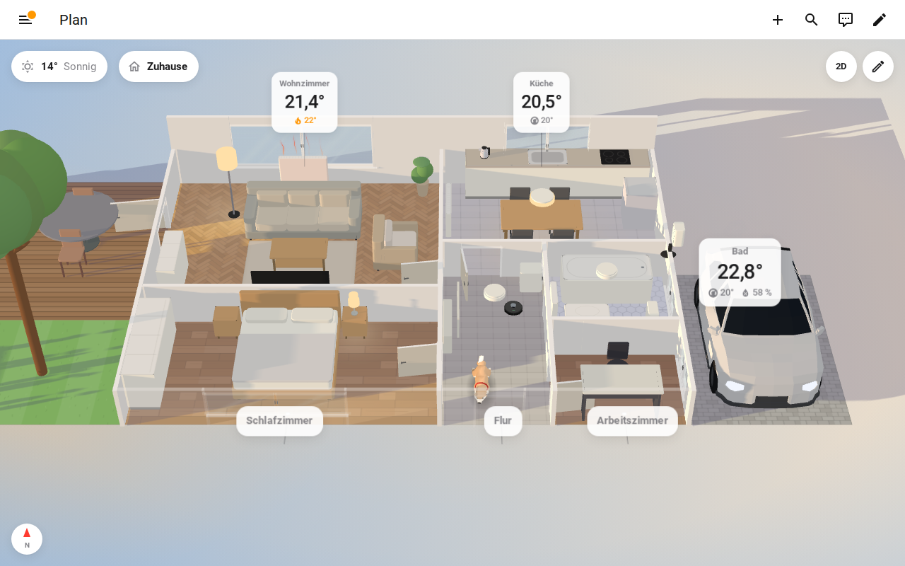

> **Beta.** roomwise is used every day in one home and tested against a test instance with simulated
> devices, but it has not been run in many other homes yet. Expect rough edges, and please
> [report them](https://github.com/jonasstack/roomwise/issues). The interface is German first; the card also speaks
> English, Hausregeln for now only German.

| | |
|---|---|
| 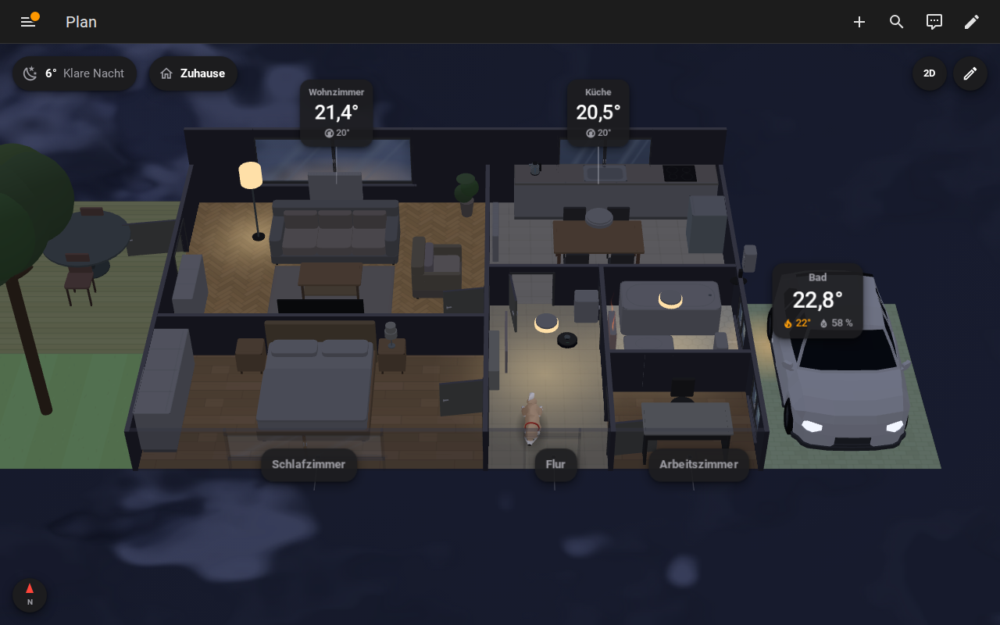 | 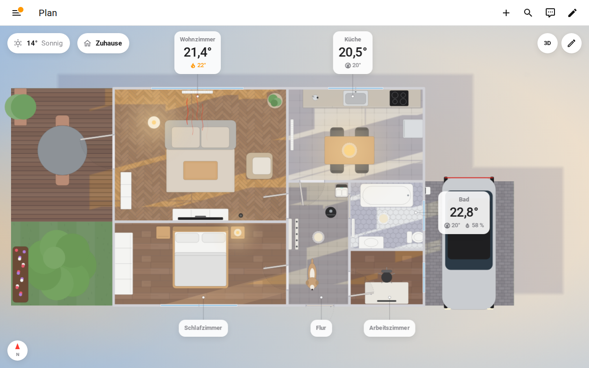 |
| 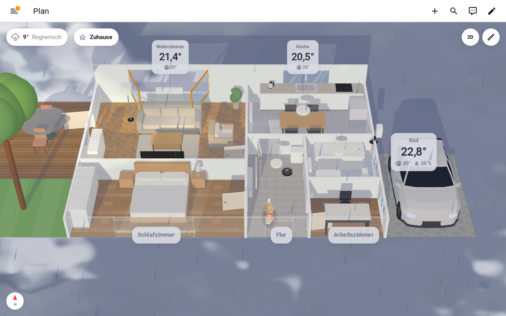 | 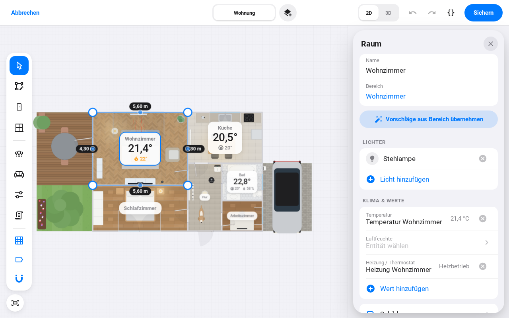 |

All screenshots show the demo home from [`examples/demo.json`](examples/demo.json).

## Contents

- [What it does](#what-it-does)
- [Requirements](#requirements)
- [Installation](#installation)
- [First steps](#first-steps)
- [Configuration](#configuration)
- [Supported devices](#supported-devices)
- [Browser support](#browser-support)
- [Wall tablets](#wall-tablets)
- [Privacy](#privacy)
- [FAQ and troubleshooting](#faq-and-troubleshooting)
- [Roadmap](#roadmap)
- [How roomwise is made](#how-roomwise-is-made)
- [License and credits](#license-and-credits)

The [user guide](docs/guide/README.md) walks through everything step by step.

## What it does

**Draw your home.** An editor inside the card: rooms point by point or as rectangles, with real wall lengths
(1 unit = 1 cm), doors and windows on the walls, several floors, outdoor areas like a terrace, a garden or a
driveway, the property line, and garages (attached or as a building of their own).
More than 130 kinds of furniture and appliances, floor materials and wall colours. Assign a room to a Home
Assistant area and its lights, thermometer, thermostat and window contacts are suggested. No YAML needed;
the plan is saved into the dashboard like any other card.

**See and switch.** The plan shows the real state of the home: lit rooms glow warm, lamps shine in their own
colour, radiators show when they heat, open windows and doors open on the plan, temperatures and humidity sit on
the rooms. A tap switches, a long press opens a popup made for the device (light, thermostat, blinds, garage door,
media, vacuum, mower, valve, to-do list, car), and every gesture can be changed to another action. The view is a calm 3D model with
the real sun, sky and weather around it, or a flat 2D plan.

**Rules that read like sentences.** Hausregeln writes automations as sentences: *When the front door opens and
nobody is home, send me a message.* You build them with a sentence editor or type them, and every run is
logged with its reason, so "why did the light just turn on?" has an answer. It also lists the automations you
already have and suggests rules from the devices it finds.

**Light by room.** Instead of ten rules per room, each room gets a light plan: what happens when someone comes
in, when the room is empty, at night, while the TV runs. Lights you switch by hand are left alone for a while.

**Heating by room.** A target per room from schedules and the house mode, off or frost protection while a window
is open, warm-up times learned per room, and reminders to air the room based on humidity, CO₂ or the time of day.

**House mode and presence.** Home, away, sleeping, vacation or guests, switched automatically from who is
home and which rooms are in use. Rooms know whether someone is in them from motion and presence sensors, and
door logic keeps a room occupied while its door is closed.

**Alarm system.** Armed away, night or home, with entry and exit delays, sirens and lights, notifications to
phones (with a disarm button guarded by the phone's own lock), optional PIN or Face ID / Touch ID for disarming,
and a window warning when the front door opens while windows are still open.

**The rest.** A robot vacuum that drives live across the plan (Roborock, Dreame, Xiaomi, Valetudo), garage doors and gates that open live
from their `cover` (opening always asks first), a robotic mower working its lawn in lanes, irrigation zones that
show the water while their valve runs, cars with battery and charging, solar, home battery and heat pump, dogs that wait at the door when a walk is due, and a vacation mode that replays
the light of your real days.

| | | |
|---|---|---|
| 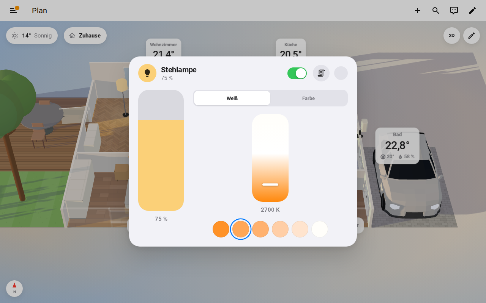 | 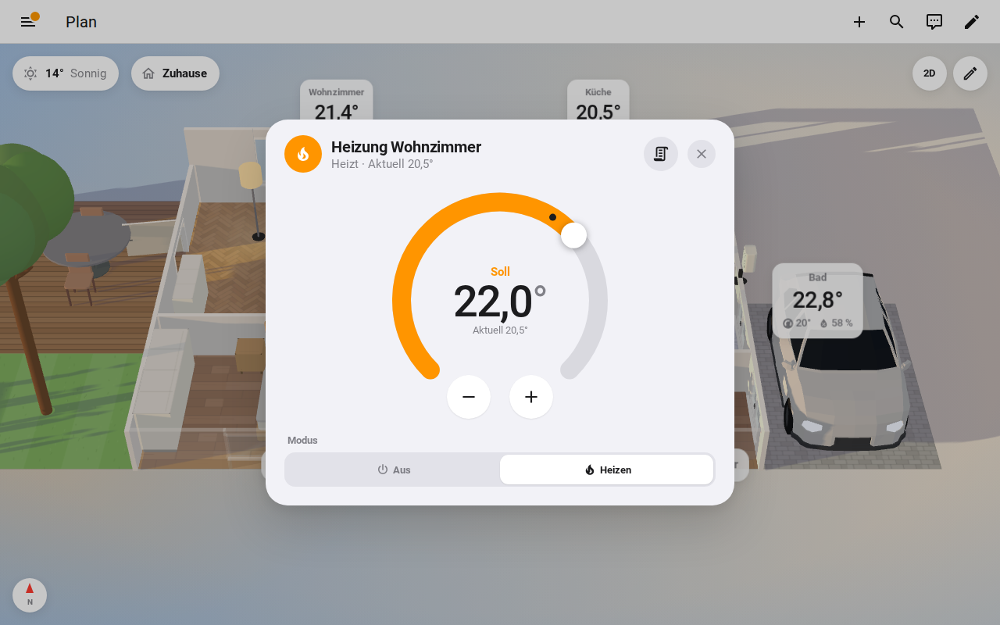 | 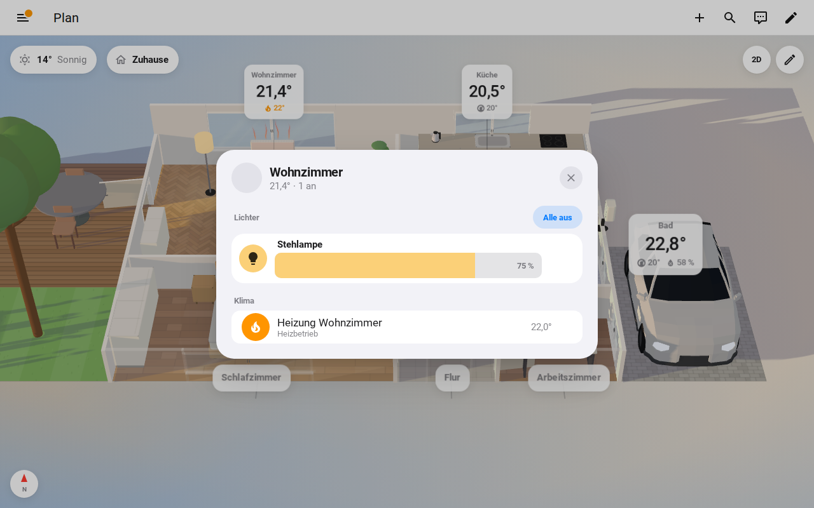 |
| 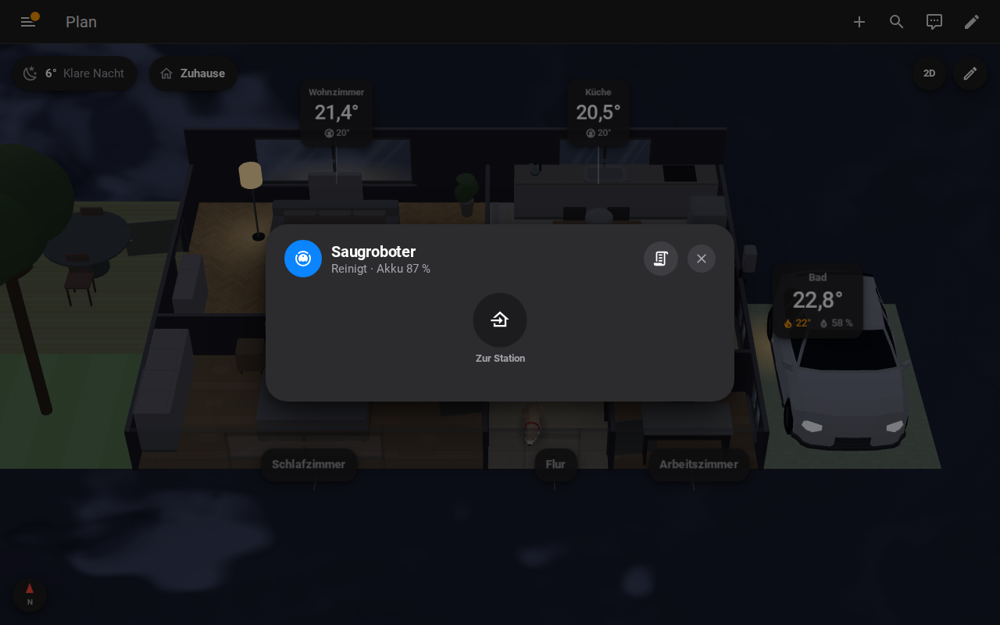 | 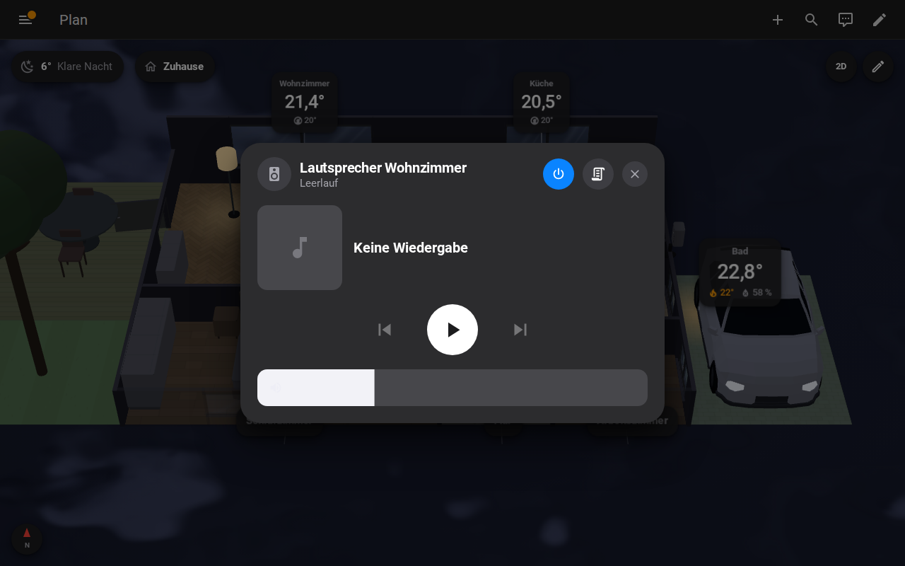 | 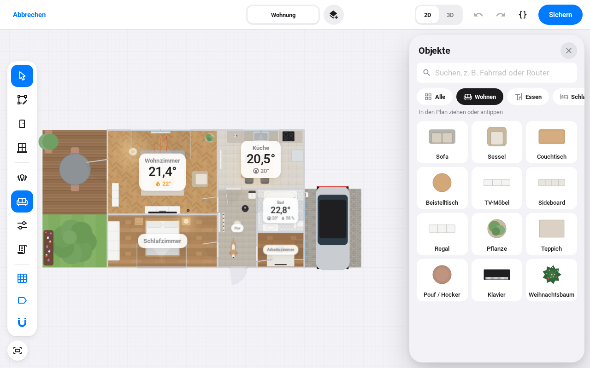 |

## Requirements

- Home Assistant 2025.1 or newer
- HACS 2.x for installation and updates
- A dashboard in storage mode (the default, edited in the UI) if you want to save from the card's editor
- For the 3D view a browser with WebGL; without it the card falls back to a simpler 3D view or 2D

## Installation

roomwise is one integration: it brings the card to every dashboard, runs what must work without a tablet (front
door alert, walk reminders, live vacuum) and adds **Hausregeln** (rules, house mode, light and heating plans,
alarm) to the sidebar.

1. HACS → ⋮ (top right) → **Custom repositories** → URL `https://github.com/jonasstack/roomwise`, type
   **Integration** → **Add**.
2. Open *roomwise* in HACS → **Download**.
3. Restart Home Assistant.
4. Settings → Devices & services → **Add integration** → *roomwise*. There is nothing to fill in.
5. Reload the browser (on a tablet: reload the kiosk app). The card is now available on every dashboard (no
   resource to add), and **Hausregeln** appears in the sidebar. Its setup assistant opens on first use; every step
   can be skipped.

Manual install: download `roomwise.zip` from the [latest release](https://github.com/jonasstack/roomwise/releases) and
unpack it so that `manifest.json` lies directly in `<config>/custom_components/roomwise/`.

After installation only the automatic house mode runs. Everything else (alarm, light plans, heating, vacation,
AI) stays off until you switch it on in the setup assistant or under Settings → Features in Hausregeln.

**Coming from 0.1.0-beta.2 or earlier** (two integrations, *Grundriss-Karte* `floorplan_card` and *Hausregeln*
`house_rules`): install roomwise, delete the folders `custom_components/floorplan_card` and
`custom_components/house_rules` (not the integrations under Devices & services – that would delete their
settings), restart. roomwise takes over settings, rules and entities with the same entity ids. The actions are now
called `roomwise.run`, `roomwise.pause` and `roomwise.reset_alarm_pin`.

## First steps

1. Create a dashboard for the tablet and set its view type to **Panel**, so one card fills the screen.
2. Edit the dashboard → **Add card** → *Floorplan Card*. If you use areas in Home Assistant, the card starts with
   one rectangle per area, already linked to its lights and sensors.
3. Tap the **pencil** and draw your rooms. Drag corners to fix wall lengths or type exact lengths.
4. Select a room and choose its **area**: lights, thermometer, thermostat and window contacts are suggested.
   Place doors and windows on the walls and give them their contact sensors.
5. Drag devices from the entity list and furniture from the library onto the plan. Link a lamp or a radiator to
   its entity so it lights up or shows heat.
6. Tap **Save**.

The [user guide](docs/guide/README.md) covers the first floor plan, devices, rules, heating and the alarm in
more detail.

## Configuration

Everything can be set in the card's editor (the gear in the editor holds the card settings). The configuration
is stored as ordinary card YAML; these are the options you are most likely to look for:

| Option | Default | Meaning |
|---|---|---|
| `title` | none | Title in the top left corner |
| `height` | from the plan | CSS height, e.g. `calc(100vh - 56px)` |
| `view_mode` | `auto` | `auto` (3D where the device manages it), `3d` or `2d`; the button in the card still switches |
| `performance` | `high` | `high` or `eco` (lower 3D resolution, no idle animations) |
| `effects` | `auto` | `auto`, `on` or `off` for animations; `auto` respects "reduce motion" |
| `weather` | first `weather.*` | Weather entity for sky and weather effects |
| `north` | `0` | Direction of north in the plan, degrees clockwise |
| `theme` | `auto` | `auto`, `light` or `dark` |
| `editable` | `true` | Show the pencil (only ever shown to administrators) |
| `users.<user id>` | none | Per-user defaults such as `view_mode`, `performance` or `floor` |
| `floors` | | Rooms, openings, devices and furniture per floor, written by the editor |

Taps, double taps and long presses on rooms, devices, doors and windows use the familiar Home Assistant action
format (`toggle`, `more-info`, `perform-action`, `navigate`, `url`, `none`) plus the card's own `toggle-lights`,
`popup` and `zoom`. Any action can ask first with `confirmation: true`; locks, alarm panels and sirens always ask.

A small hand-written example is in [`examples/basic.yaml`](examples/basic.yaml), the demo home from the
screenshots in [`examples/demo.json`](examples/demo.json).

## Supported devices

roomwise works with entities, not with brands: if Home Assistant shows a light, a thermostat or a contact
sensor, the card can use it. Some features need more than the standard entities:

| Feature | Works with | Limits |
|---|---|---|
| Lights, switches, fans, covers, media players, climate | any integration | Colour and colour temperature only where the light reports them |
| Doors and windows | any `binary_sensor` with open/closed | |
| Room occupancy (Hausregeln) | motion, presence and occupancy sensors, presence zones | Rooms with only a door contact use door logic alone |
| Robot vacuum popup and room cleaning | any `vacuum` entity | Room selection needs `vacuum.clean_area` support, or (with the roomwise integration) a robot whose integration cleans segments: Dreame Vacuum, Xiaomi Miio, Valetudo (MQTT) |
| Robot vacuum driving live on the plan | **Roborock** (core integration), **Dreame Vacuum**, **Xiaomi Cloud Map Extractor** or any map camera with `calibration_points` (Xiaomi Vacuum Map Card style), **Valetudo** (its "Map data" camera) | The map source is found by itself. Besides Roborock only tested against simulated robots in the integrations' real formats. Map cameras update every few seconds, so the robot is shown further behind. Other brands get the popup without the live view |
| Cars | built with Mercedes me, works with generic battery, range, charging and location entities | Charge limit and pre-climate depend on what the car's integration offers |
| Heating (Hausregeln) | `climate` entities; optional room thermometers and window contacts | Valve position hints only where the thermostat reports it |
| Alarm notifications | Home Assistant companion app, `notify` services, e-mail via your SMTP server, Telegram and Signal via CallMeBot | Critical alerts depend on the phone and the app |
| Sentence rules | built-in parser for German; optional AI (Ollama, Gemini, OpenAI, Anthropic, Mistral, OpenAI-compatible) | No English sentences yet |

If something doesn't show up or behaves oddly, a [device support request](https://github.com/jonasstack/roomwise/issues/new/choose)
with the entity's attributes helps more than anything else.

## Browser support

<!-- TODO: browser support matrix (filled in separately) -->

*Coming soon.*

## Wall tablets

The card is built for screens that never turn off. It doesn't poll, the 3D scene only redraws when something
changes, and idle animations slow down and stop on an untouched tablet.

- Under *Effects & performance* in the editor (also per user) choose *Full*, *Saver* or *Off*. *Saver* keeps
  the sky static and renders 3D at a lower resolution, which suits older or cheap tablets.
- 2D is the lightest view.
- Hold the compass for two seconds to see frames per second, frame time, resolution and the GPU in the card.
- A kiosk app such as Fully Kiosk Browser hides Home Assistant's header and sidebar and handles screen dimming.

Performance has so far been measured in desktop Chromium with the CPU throttled to tablet speed, not yet on a
range of real tablets. Numbers from the stats overlay together with your tablet model are very welcome.

## Privacy

Everything stays in your Home Assistant. The card and the roomwise integration don't contact any service
on the internet; even the 3D models come from your own instance. Hausregeln only talks to the outside when an
administrator sets it up: the AI provider you choose, CallMeBot for Telegram and Signal, your own SMTP server.

Anonymous diagnostics, if they are added, will be opt-in, off by default, and show what would be sent before
anything is sent. See [PRIVACY.md](PRIVACY.md) for the details.

## FAQ and troubleshooting

**"Custom element doesn't exist: floorplan-card".**
Restart Home Assistant after installing, add the integration under Settings → Devices & services, then reload the
browser. If it persists, clear the browser or kiosk app cache. If you once added the card as a dashboard resource
by hand, remove that resource.

**I don't see the pencil.**
Only administrators can edit, and `editable: false` hides it. On a tablet that logs in as a normal user this is
intended.

**Saving fails.**
The editor can only save into dashboards managed in the UI. For YAML dashboards use the `{}` button in the
editor and paste the configuration yourself.

**Tapping a room doesn't switch the lights.**
The room needs lights: assign an area or pick lights in the room settings.

**The tablet gets warm or the 3D view stutters.**
Switch to *Saver* or *Off* under Effects & performance for that tablet's user, or use 2D.

**The vacuum doesn't move on the plan.**
The live view needs the roomwise integration and a robot whose integration reports its position (Roborock,
Dreame Vacuum, Xiaomi Cloud Map Extractor, Valetudo). Select the vacuum in the editor: it shows where the
position comes from (or that none was found) and lets you pick another map entity. Then align its map to the plan.

**Which language does it use?**
Your Home Assistant language: German for `de`, English otherwise. Hausregeln is German only for now.

**Does roomwise replace my automations?**
No. Hausregeln runs next to them, lists them, and can suggest turning a group of them into one rule, but it never
changes an automation on its own.

## Roadmap

- One integration instead of two, installed in one step through HACS, with the existing settings carried over
- Hausregeln in English, including sentence rules
- More devices with live positions (vacuums, mowers) where integrations expose them
- Opt-in anonymous diagnostics to learn which devices and tablets people use

Ideas and wishes are welcome as [feature requests](https://github.com/jonasstack/roomwise/issues/new/choose).

## How roomwise is made

roomwise is developed by jonasstack together with Anthropic's Claude (Claude Code) as a coding partner.
What roomwise should do, how it should feel and whether a change is good enough comes from me and from living
with it every day; most of the code is written in conversation with Claude, then run, tested on a test instance
and in a real home, and reworked until it behaves. I mention it because it is simply how the project is made.

Contributions are welcome, see [CONTRIBUTING.md](CONTRIBUTING.md).

## License and credits

roomwise is released under the [MIT License](LICENSE).

The dog and car models are by [Quaternius](https://quaternius.com) (CC0), the alarm sounds from
[BigSoundBank](https://bigsoundbank.com) (CC0). The card bundles [Lit](https://lit.dev) and
[three.js](https://threejs.org); the Hausregeln panel bundles Lit and icons from
[Material Design Icons](https://pictogrammers.com/library/mdi/). Details and licenses are in
[THIRD_PARTY.md](THIRD_PARTY.md).
